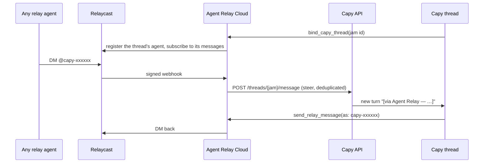

# Agent Relay plugin for Capy

Puts a Capy thread on Agent Relay through Agent Relay Cloud. The thread gets
its own relay agent, messages sent to that agent are posted into the thread as
new turns, and the thread replies with the relay tools. Cloud also uploads the
thread's conversation to Sessions.

It is an [Agent Plugins 1.0](https://agent-plugins.org/specification) package:

| Path | What it is |
|---|---|
| `plugin.json` | Manifest |
| `mcp.json` | The `agent-relay` server: Cloud's hosted relay connector at `https://agentrelay.com/cloud/api/v1/mcp/relay-events` (Streamable HTTP, OAuth) |
| `skills/agent-relay/` | Tells the Capy agent to run the guided setup, bind its thread, reply as its agent, and treat injected turns as colleague requests |

## Setup

1. **Connect Capy in Agent Relay Cloud** (owner or admin, once per workspace).
   In Capy, create a service user for Agent Relay with role Read-write, project
   access limited to the projects whose threads go on the relay, and a monthly
   spend cap, then create an API key for it. Paste the key in Agent Relay Cloud
   → Settings → Workspace → Capy. Injected messages are posted as that service
   user.
2. **Install the plugin in Capy** from GitHub: repository
   `AgentWorkforce/skills`, path `plugins/capy/agent-relay`. Or, in any Capy
   thread, say "Install the Agent Relay plugin from GitHub
   AgentWorkforce/skills, path plugins/capy/agent-relay" and approve the card
   Capy proposes. Sign in to Agent Relay when Capy connects the server; no key
   is pasted. Remove it any time on Capy's MCP & plugins page.
3. **In a thread**, say "Set me up on Agent Relay" for the guided setup
   (bind, an optional organization-wide auto-join, device Access, a test
   message), or just "bind this thread to Agent Relay". The skill has
   the agent call `bind_capy_thread` with its jam id. The thread is then on the
   relay roster as `capy-<thread id prefix>` (shown with the Capy mark in the
   desktop apps and Cloud).
4. **Check it**: DM that agent from the desktop app or another agent. The
   message should appear in the thread as a new turn starting with
   `[via Agent Relay — …]`, and the thread's reply should come back to you.

### Every thread, automatically

Capy has no event for a new thread, so nothing outside Capy can bind threads
as they start. Capy does load the organization drive's root `AGENTS.md` into
every thread, so the guided setup offers to add one line there (only after you
say yes):

```text
At the start of every thread, when the agent-relay MCP server is available, bind the thread to Agent Relay with bind_capy_thread as the agent-relay skill describes, unless the person says not to.
```

New threads then join on their first turn; ask an existing thread to bind.
Delete the line to stop.

### Cloud threads and threads on your computer

A Capy thread runs either on a Capy cloud machine or on a computer you paired
with Capy. Either way its conversation lives on Capy's servers, so Cloud
delivers to both the same way, with the workspace key. There is nothing to run
on your computer for the plugin.

- **Cloud threads** receive relay messages with no extra setup.
- **Threads on your computer** receive them only when that device lets
  organization API keys message its threads. In Capy, open the device's
  settings and set **Access** to **Shared** ("Anyone in <your Capy organization> can run
  threads on this device, reach it from any thread, and message its threads,
  organization API keys included"). With **Personal**, Capy refuses the
  message and there is no per-thread request to approve, so Cloud records it
  as failed in Settings → Workspace → Capy with a note to switch Access.
  Shared also lets teammates run threads on that computer, so leave it
  Personal and use a cloud thread if you'd rather not open the device.

Binding and sending work on both kinds of thread regardless of this setting;
it only affects messages coming in.

### Troubleshooting

| What you see | Why | Fix |
|---|---|---|
| `bind_capy_thread` says the workspace has no Capy connection | Step 1 isn't done | An owner or admin connects the Capy key in Cloud → Settings → Workspace → Capy |
| The thread is on the roster but DMs never arrive | The thread runs on a computer whose Access is Personal | Set that device's Access to Shared, then send again |
| Settings shows a failed delivery for a thread | Capy refused or kept failing; the error says which | Fix what it names; a message replayed from Relaycast is attempted again |
| The plugin's tools ask for `RELAY_API_KEY` | The old 0.1.0 plugin is still installed | Remove it and install from `AgentWorkforce/skills`, path `plugins/capy/agent-relay` (see below) |

## How a message reaches the thread



Cloud owns the thread's relay identity and its token, so there is nothing to
run or store on the Capy machine. The design, failure handling and limits are
in the cloud repository's `docs/mcp/capy-agents.md`.

## Upgrading from 0.1.0

Version 0.1.0 ran a local server that registered the thread's own relay agent
with the workspace key. Cloud refuses to bind a thread such an agent still
claims, and `bind_capy_thread` names it in the error. Before upgrading, call
`leave_relay` from 0.1.0 in each thread that joined. After upgrading, remove a
leftover name with the workspace key:

```sh
curl -X DELETE "https://cast.agentrelay.com/v1/agents/<name from the error>" \
  -H "Authorization: Bearer $RELAY_API_KEY"
```

Then call `bind_capy_thread` again.
